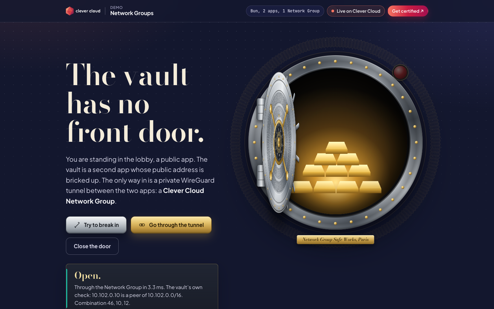
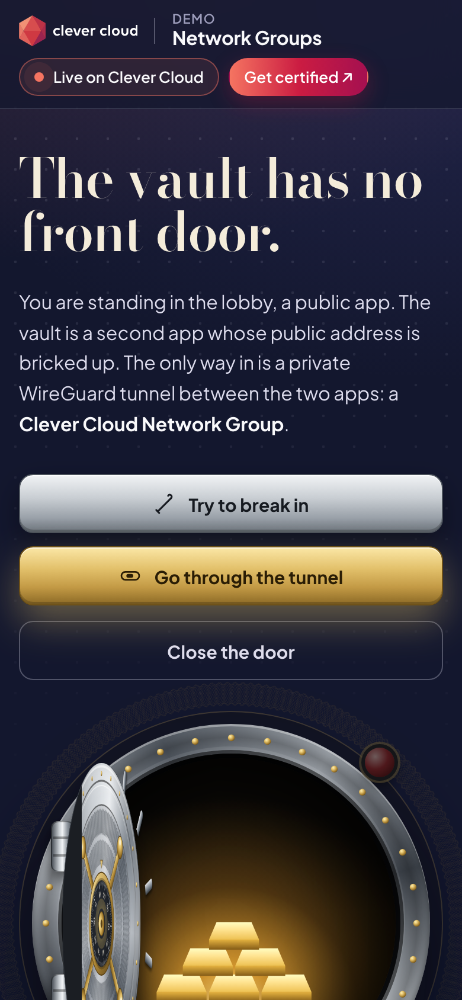

# The Vault: Clever Cloud Network Groups

> Two apps and a private tunnel. The **lobby** is a public Bun app. The **vault** is a second app whose public address is bricked up: Clever's Request Flow `block` mode answers its default domain, so no request from the internet ever reaches its code. The only way in is a **Network Group**, a WireGuard mesh between the two apps. Press "Try to break in" and the lobby's server attacks the vault's public address three ways, and fails three times. Press "Go through the tunnel" and the same server calls the vault at its private member name: the dial spins, the bolts retract, the door swings open on the crown jewels.



| On a phone | |
|---|---|
|  | Every value on the page is live: the Network Group id, both members' private names and WireGuard addresses, the DNS / tunnel / vault timings of the last trip, the vault's own door ledger, and the guard's logbook of every request the lobby sent. |

**Run it yourself.** The hosted demo was taken down after the presales review (November 2026). The steps in [Deploy on Clever Cloud](#deploy-on-clever-cloud) recreate it from scratch, both apps and the Network Group, in about 15 minutes.

**Get certified.** This demo runs on Clever Cloud. To deploy your own apps the same way, get certified at the [Clever Cloud Academy](https://academy.clever.cloud/).

---

## What the Network Group does here

A [Network Group](https://www.clever.cloud/developers/doc/network/network-groups/) links Clever Cloud resources over WireGuard. Each member gets a DNS name, `<memberID>.m.<ngID>.cc-ng.cloud`, and each instance (peer) an IP from the group's CIDR. Inside the group, **any port** of a member is reachable.

| | The street (break-in) | The tunnel |
|---|---|---|
| Address | `https://app-<vault>.cleverapps.io/treasure` | `http://<vault app id>.m.<ng id>.cc-ng.cloud:9000/treasure` |
| Who answers | Clever's block service: `200`, body `OK`, 2 bytes, no vault seal | The vault app: `200`, JSON inventory, `X-Vault-Seal` header |
| Port 9000 on the public host | `connection refused` | reachable, inside the group |
| The private name on a public resolver (1.1.1.1) | `NXDOMAIN` | resolves to the member's private address inside the group (a `10.…` subnet chosen per group) |
| Measured from the lobby | about 10 to 15 ms, never the vault | DNS 0.5 ms, tunnel round trip about 2 ms, vault work about 0.2 ms |

Two locks keep the vault private:

1. **The public door is bricked up by the platform.** `CC_REQUEST_FLOW=block` puts a Clever service on the public port 8080 that answers `200 OK` to everything ([Request Flow doc](https://www.clever.cloud/developers/doc/develop/request-flow/#block-public-access)). The vault listens on `PORT=9000`, which only Network Group peers can reach. No domain was removed: the default domain stays, and it gets the block page.
2. **The vault checks every caller.** It resolves its own member name, finds the local interface holding that IP (`wg-<end of the ng id>` on Clever, with a private `/16` address whose subnet changes from one group to another), and refuses any caller outside that subnet with `403`. Its door ledger counts who got in.

What the vault answers is signed with an `X-Vault-Seal` header and a `Server-Timing` header. The lobby uses the first to tell the real vault from the block page, and the second to split the trip into DNS, tunnel and vault time.

## Deploy on Clever Cloud

Three resources, all from this one repository:

- **the lobby** `demo-network-groups` (alias `lobby`), public, started by `scripts.start`;
- **the vault** `demo-network-groups-vault` (alias `vault`), whose public port is blocked, started by `CC_RUN_COMMAND`;
- **the Network Group** `demo-network-groups`, with both apps as members. That is the only link between them: the lobby reaches the vault at its member name, `VAULT_URL`, on port 9000.

You need [clever-tools](https://www.clever.cloud/developers/doc/cli/) (`clever login` done; on older versions also `clever features enable ng`), `jq`, and the ID of the organisation that will own the resources (`orga_…`, shown in the Console). Run the commands from the repo root: both `clever create` calls link the same folder, one alias each.

```bash
# 1. The two apps and their size
clever create --type node demo-network-groups --alias lobby --org <org_id> --region par
clever create --type node demo-network-groups-vault --alias vault --org <org_id> --region par
for a in lobby vault; do
  clever scale --alias "$a" --min-flavor nano --max-flavor XS --min-instances 1 --max-instances 2
  clever scale --alias "$a" --build-flavor M
done
clever applications                     # the app_… id of each alias

# 2. The Network Group, with both apps as members
clever ng create demo-network-groups --link <lobby_app_id>,<vault_app_id> --org <org_id>

# 3. The vault: public port bricked up, private port 9000
clever env set CC_REQUEST_FLOW block --alias vault
clever env set PORT 9000 --alias vault
clever env set CC_RUN_COMMAND "bun src/vault.ts" --alias vault
clever env set NODE_ENV production --alias vault

# 4. The lobby: the vault's private member name, and its public domain for the break-in
clever env set VAULT_URL "http://$(clever ng get <vault_app_id> --org <org_id> -F json | jq -r .domainName):9000" --alias lobby
clever domain --alias vault             # the vault's default app-<id>.cleverapps.io domain
clever env set VAULT_PUBLIC_URL https://<vault-app>.cleverapps.io --alias lobby
clever env set NODE_ENV production --alias lobby
clever env set CC_HEALTH_CHECK_PATH /health --alias lobby

# 5. Deploy, the vault first
clever deploy --alias vault
clever deploy --alias lobby
clever open --alias lobby
```

Both apps deploy the same repository on the Node.js & Bun runtime (the `bun.lock` file selects Bun). On the vault, block mode replaces the HTTP health check: the deployment only checks the block service on 8080, so `CC_HEALTH_CHECK_PATH` is set on the lobby only. There is no add-on, no secret to generate and no setup script. Check the tunnel with `GET /health/deep` on the lobby: it calls the vault through the Network Group.

## Variables

| App | Variable | Role |
|---|---|---|
| lobby | `VAULT_URL` | The vault's member name and private port, from `clever ng get` |
| lobby | `VAULT_PUBLIC_URL` | The vault's default domain, the target of the break-in |
| vault | `CC_REQUEST_FLOW=block` | Clever answers the public port in place of the app |
| vault | `PORT=9000` | Where the vault listens (the Request Flow doc's application port) |
| vault | `CC_RUN_COMMAND` | `bun src/vault.ts` |
| both | `NODE_ENV=production` | Required by the runtime doc |

There is no add-on. The Network Group injects no variable: the apps learn everything from the member name and their own network interfaces. The page shows only the lobby's platform variables (`CC_APP_NAME`, `APP_ID`, `INSTANCE_NUMBER`, `INSTANCE_TYPE`, `CC_PRETTY_INSTANCE_NAME`, `CC_COMMIT_ID`, `CC_DEPLOYMENT_ID`).

## Routes

**Lobby** (public): `GET /`, `GET /health` (200, touches nothing), `GET /health/deep` (calls the vault through the Network Group), `GET /api/state`, `POST /api/tunnel`, `POST /api/break-in`, `POST /api/deposit` (`{"kind":"bar"|"gem"|"coin"|"pearls"}`, a fixed menu, no free text).

**Vault** (port 9000, Network Group only): `GET /health`, `GET /health/deep`, `GET /manifest`, `GET /treasure`, `POST /deposits`. Everything but `/health` goes through the subnet check.

Guard rails for a public demo: 40 actions per minute per visitor (12 deposits), at most 6 break-ins in flight, 1 KB request bodies, at most 48 visitor deposits kept, strict CSP with no inline script. The inventory is generated from a fixed seed at startup, so the strong room is never empty and is identical after every restart. Visitor deposits live in the vault's memory and disappear when it restarts.

## Run it locally

```bash
bun install
PORT=8730 bun src/vault.ts                       # local mode: only 127.0.0.1 may call it
PORT=8733 VAULT_URL=http://127.0.0.1:8730 VAULT_PUBLIC_URL=http://127.0.0.1:8734 bun src/lobby.ts
bun test                                         # unit + end-to-end, with a stand-in for the block service
```

Bun 1.3 or later. Locally there is no Network Group, so the panel says "local mode" and the break-in DNS step is skipped.

## Project structure

```
src/vault.ts        the private app: subnet check, inventory, deposits, door ledger
src/lobby.ts        the public app: page, the tunnel call, the three break-in attempts
src/lib/ng.ts       member names, CIDR math, finding the WireGuard interface
src/lib/probe.ts    timed calls: through the tunnel, public HTTP, raw TCP, public DNS
src/lib/treasure.ts the seeded crown jewels and the deposit menu
public/             the page: door (SVG + CSS 3D), roads, strong room, Network Group panel
test/               bun test
```

Visual universe: a round bank-vault door drawn in SVG and CSS 3D, with banknote guilloché engraving generated in the browser, Bodoni Moda for the engraved lettering, and the Clever Brand Kit frame. No image file besides the Clever logo and badge.

MIT License. Built by the Clever Cloud presales team.
